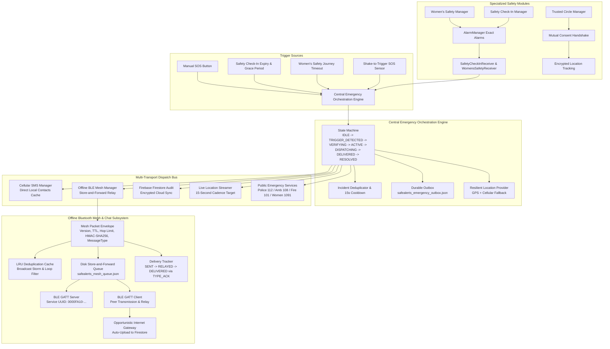

# SafeAlerts — Technical Architecture Specification

## 1. System Overview

SafeAlerts is a resilient personal safety and emergency response system for Android (API 24 to 34). It is engineered to operate across all operational environments:
1. **Full Network Connectivity:** Cloud Firestore synchronization, live location streaming, and Trusted Circle sharing.
2. **Cellular-Only Connectivity:** Automatic offline contact dispatch via direct cellular SMS with embedded GPS coordinates and medical briefing.
3. **Total Network Blackout:** Peer-to-peer Bluetooth Low Energy (BLE) text chat and multi-hop store-and-forward mesh routing.

---

## 2. System Architecture Diagram



---

## 3. Emergency Orchestration State Machine

The central engine (`EmergencyManager.kt`) enforces the following deterministic lifecycle:

```
+-------------------------------------------------------+
|                         IDLE                          |
+-------------------------------------------------------+
                           |
            Trigger Event (Manual / Timer / Shake / Journey)
                           v
+-------------------------------------------------------+
|                   TRIGGER_DETECTED                    |
|    Rate limit check (15s cooldown) & Deduplication    |
+-------------------------------------------------------+
                           |
                           v
+-------------------------------------------------------+
|                      VERIFYING                        |
|       Countdown (5s default) with Cancel Option       |
+-------------------------------------------------------+
            |                               |
       User Cancels                     Countdown Expires / Immediate Confirm
            v                               v
+-----------------------+       +------------------------------------+
|       CANCELLED       |       |          EMERGENCY_ACTIVE          |
+-----------------------+       |  1. Generate Incident UUID         |
                                |  2. Persist to Durable Outbox      |
                                |  3. Acquire GPS (or safe fallback) |
                                +------------------------------------+
                                            |
                                            v
                                +------------------------------------+
                                |            DISPATCHING             |
                                | 1. Cellular SMS via Local Cache    |
                                | 2. Offline BLE Mesh broadcast      |
                                | 3. Cloud Firestore audit write     |
                                | 4. Start 15s Live Location stream  |
                                +------------------------------------+
                                            |
                                            v
                                +------------------------------------+
                                |    ALERTS_PENDING_OR_DELIVERED     |
                                | Continuous mesh relay + live track |
                                +------------------------------------+
                                            |
                                      Explicit Resolve
                                            v
                                +------------------------------------+
                                |              RESOLVED              |
                                +------------------------------------+
```

---

## 4. Key Subsystem Specifications

### 4.1 Safety Check-In Timer Subsystem
- **Component:** `SafetyCheckInManager.kt`, `SafetyCheckInReceiver.kt`
- **Scheduling:** `AlarmManager.setExactAndAllowWhileIdle()` scheduled against wall-clock deadlines.
- **Grace Period State Flow:**
  - `ACTIVE` → timer hits 00:00 → if grace period > 0, transitions to `GRACE_PERIOD_ACTIVE`.
  - Notification displayed with action buttons to "Confirm I'm Safe".
  - If grace period reaches 00:00 without confirmation, `SafetyCheckInReceiver` calls `EmergencyManager.triggerEmergency()`.
- **Pause/Resume:** Freezes remaining time and cancels alarm; resume calculates new deadline and reschedules alarm.

### 4.2 Women's Safety Journey Subsystem
- **Component:** `WomensSafetyManager.kt`, `WomensSafetyReceiver.kt`, `WomensSafetyScreen.kt`
- **Journey Model:** Tracks destination name, start timestamp, target arrival timestamp, configured grace period (0, 2, 5, 10 min), and trusted contacts.
- **Actions:**
  - `Extend (+10 min)`: Dynamically shifts arrival deadline and reschedules alarm.
  - `I'm Safe`: Resolves journey without emergency escalation.
  - `Timeout Escalation`: Authoritatively triggers `EmergencyManager` with `TRIGGER_WOMENS_SAFETY` and prepares Women's Helpline (1091) escalation.

### 4.3 Trusted Circle Mutual Location Subsystem
- **Component:** `TrustedCircleManager.kt`, `TrustedCircleScreen.kt`
- **Consent Protocol:** Separate statuses for `INVITED`, `ACCEPTED`, `REJECTED`, `STOPPED`. Adding a contact does not automatically share location.
- **Location Sync:**
  - Pushes authenticated updates to `users/{uid}/trusted_circle_locations`.
  - Reads member updates only for approved mutual members.
  - Stale detection: Highlights members with last update > 15 minutes as stale.

### 4.4 Offline Text Chat & BLE Mesh Network Subsystem
- **Component:** `WalkieTalkieManager.kt`, `BleMeshManager.kt`
- **Pure Text:** All voice/microphone dependencies removed (`AudioRecord`, `AudioTrack`, PTT buttons, speech-to-text dictation).
- **Transport Envelope:**
  - `version`, `messageId`, `senderDeviceId`, `timestamp`, `expiryTimestamp`, `packetType` (`EMERGENCY_SOS`, `TEXT_CHAT`, `LOCATION_UPDATE`, `TYPE_ACK`), `messageText`, `latitude`, `longitude`, `hopCount`, `maxHops`, `signature`.
- **Delivery Confirmation:** When a peer receives a direct text message, it immediately responds with a `TYPE_ACK` packet containing the original `messageId`, advancing the message status from `SENT` or `RELAYED` to `DELIVERED`.
- **Store-and-Forward:** Unsent packets stored in `safealerts_mesh_queue.json` and retransmitted upon peer reconnection.
