# SafeAlerts

SafeAlerts is an Android personal-safety app for contacting trusted people during an emergency. It combines SOS alerts, location sharing, timed check-ins and nearby communication tools in one app.

> SafeAlerts is not a replacement for local emergency services. SMS, location and Bluetooth features depend on device permissions, hardware, connectivity and service availability.

## Features

- **SOS alerts:** Start an emergency flow from the home screen, review the alert and cancel before dispatch. Alerts can include the selected emergency type, location and a map link.
- **SMS dispatch:** Send alerts to enabled emergency contacts using Android SMS when available. The app reports dispatch status; carrier delivery is not guaranteed.
- **Location and journeys:** Share location with consent, view incident locations, and use map and route screens.
- **Safety Check-In:** Start a timed safety session and mark yourself safe. A missed check-in can trigger the configured escalation flow.
- **Trusted Circle:** Connect with other app users and manage sharing consent for circle location and incident updates.
- **Emergency triggers:** Configure supported shake and voice triggers, plus emergency protection settings.
- **Offline communication:** Nearby Bluetooth features include offline SOS broadcasts and walkie-talkie/group messaging. They require compatible nearby devices and Bluetooth permissions.
- **Contacts and history:** Manage emergency contacts and review incident and alert history.
- **Account and settings:** Firebase-backed sign-in, profile, app preferences and emergency service information.

## Screenshots

The repository includes these example screens:

| Login | Home | Settings | Alert status |
|---|---|---|---|
| 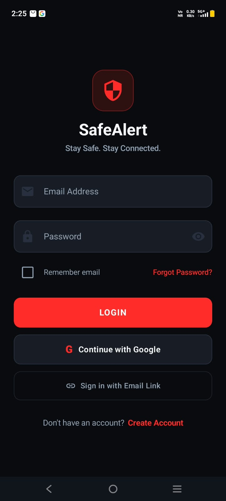 | 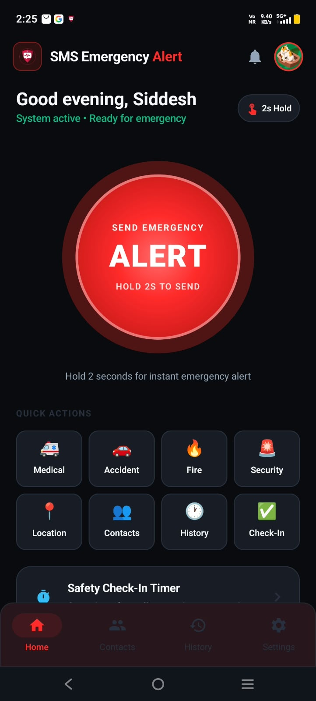 | 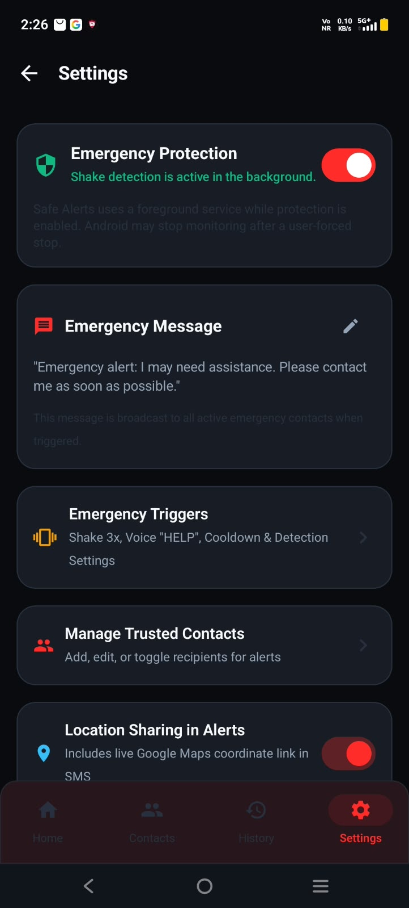 | 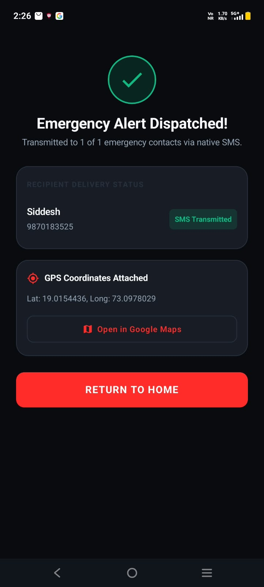 |

### More app screens

These additional screens came from the shared screenshot archive. Personal account, contact, notification and location details are hidden in the copies added here.

<table>
  <tr>
    <td>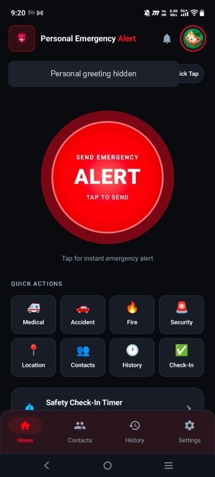<br>Home dashboard</td>
    <td>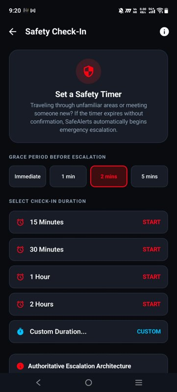<br>Safety Check-In</td>
    <td>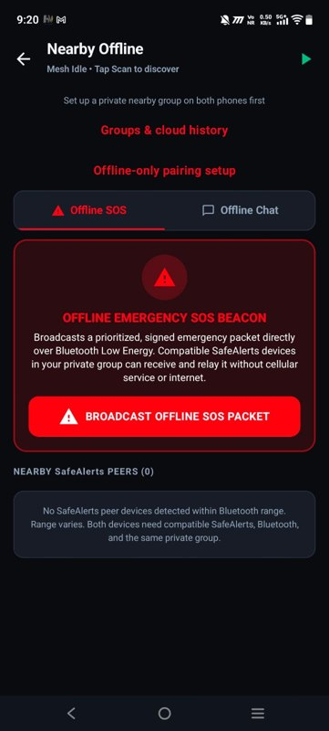<br>Nearby offline communication</td>
  </tr>
  <tr>
    <td>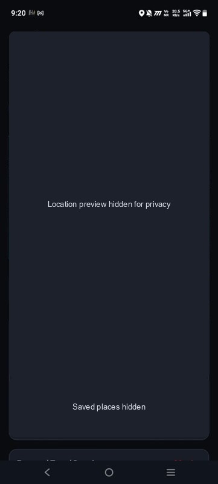<br>Women's Safety Journey</td>
    <td>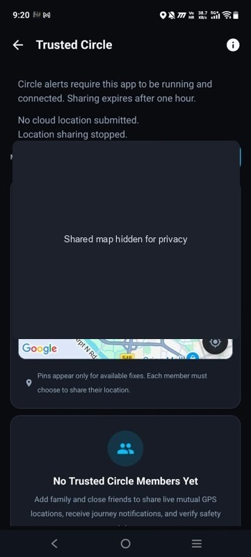<br>Trusted Circle</td>
    <td>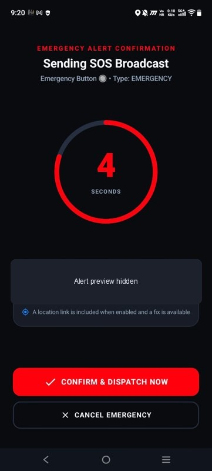<br>SOS confirmation</td>
  </tr>
  <tr>
    <td>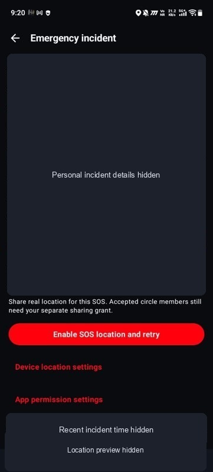<br>Emergency incident</td>
    <td>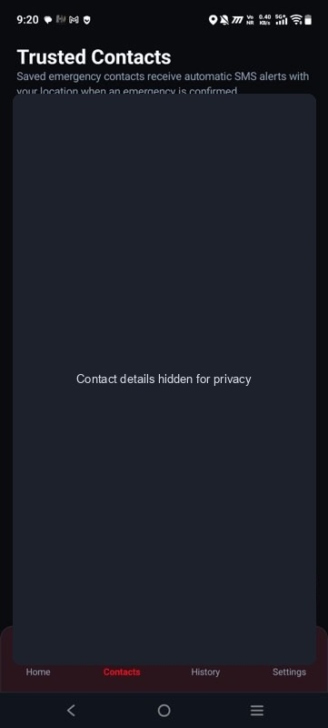<br>Trusted contacts</td>
    <td>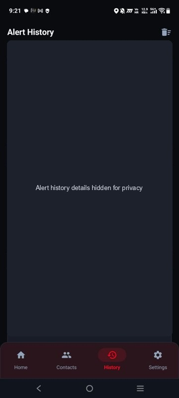<br>Alert history</td>
  </tr>
  <tr>
    <td>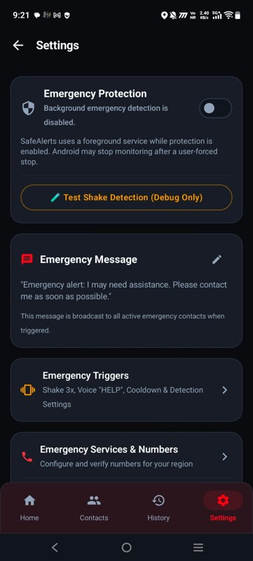<br>Settings</td>
    <td>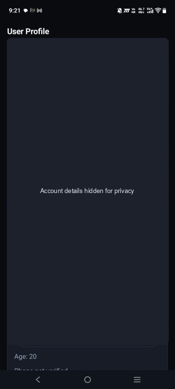<br>User profile</td>
    <td>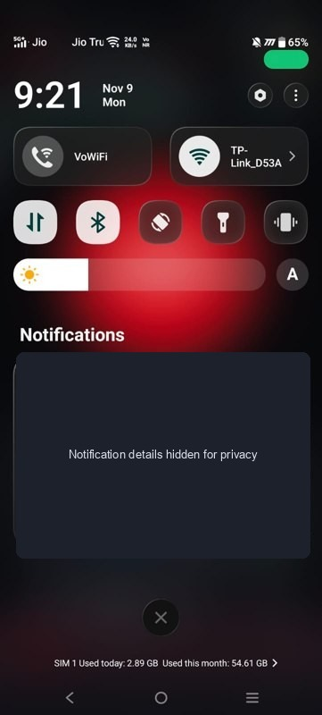<br>SMS notification</td>
  </tr>
</table>

## Technology

- Kotlin and Jetpack Compose with Material 3
- Android location, SMS, sensors, speech recognition, notifications and Bluetooth APIs
- Firebase Authentication and Cloud Firestore
- Kotlin coroutines and Android background work APIs
- Firebase Cloud Functions source is present under `functions/`; see `functions/SPARK_ONLY.md` for its deployment limitations. Do not treat that source as proof of a deployed backend.

## Requirements

- Android Studio with Android SDK
- JDK 17
- Android device or emulator running Android 7.0 (API 24) or newer
- A Firebase project for sign-in and cloud-backed features
- A physical phone with an active SIM and carrier service to test real SMS

Bluetooth communication, speech recognition and SMS behavior vary by device. A physical phone is recommended for testing these features.

## Build and run

1. Clone this repository:

   ```bash
   git clone https://github.com/corsal2006/SafeAlertss.git
   cd SafeAlertss
   ```

2. Open the project folder in Android Studio and allow Gradle to sync.

3. Configure Firebase for the Android application ID `com.siddesh.smsalerts`. Download the matching `google-services.json` from your Firebase project and place it at `app/google-services.json`. The Firebase configuration file is intentionally not tracked in this repository. See [FIREBASE_SETUP.md](FIREBASE_SETUP.md) for provider and Firestore setup.

4. Select the `app` run configuration and a device, then run the app.

To build a debug APK from the project root:

```powershell
.\gradlew.bat assembleDebug
```

The APK is written to `app/build/outputs/apk/debug/app-debug.apk`.

## Testing

Android unit tests are under `app/src/test`. Run them with:

```powershell
.\gradlew.bat testDebugUnitTest
```

For Firebase emulator and device testing notes, see [TESTING.md](TESTING.md). Real SMS delivery must be checked on a phone with a working SIM and carrier service.

## Project layout

```text
app/                 Android application
functions/           Firebase Cloud Functions source and tests
load_testing/        Load-test tooling and recorded results
screenshots/         App screenshots
tools/               Release and verification scripts
firestore.rules      Firestore security rules
FIREBASE_SETUP.md    Firebase configuration notes
TESTING.md           Testing guide
```

## Privacy and safety

The app may process account information, emergency contacts, location and incident history. Review Firebase rules and platform permissions for your deployment. Never rely on the app as the only way to contact emergency services.

## License

No license file is currently included. Contact the repository owner for permission to reuse or distribute this project.
