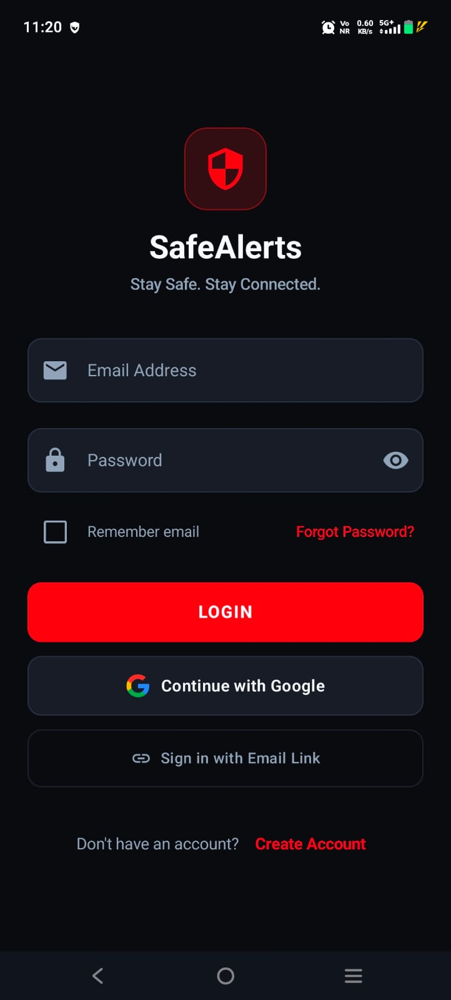
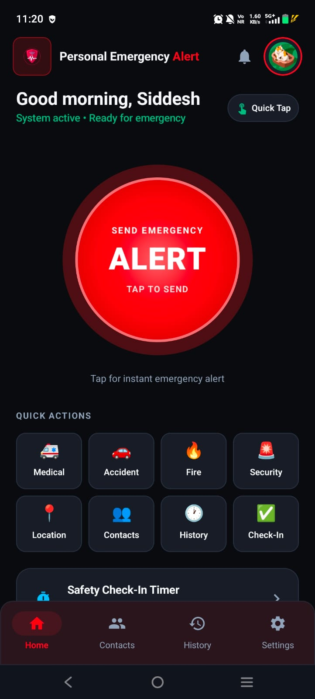
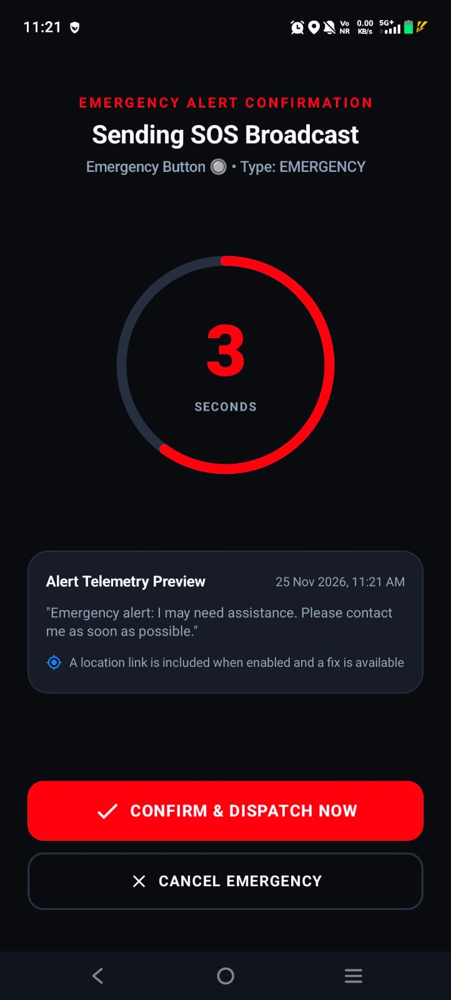
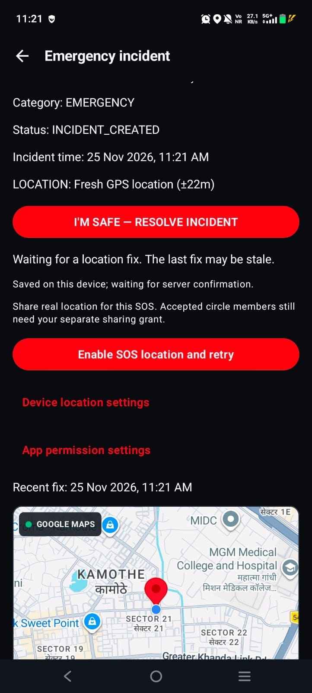
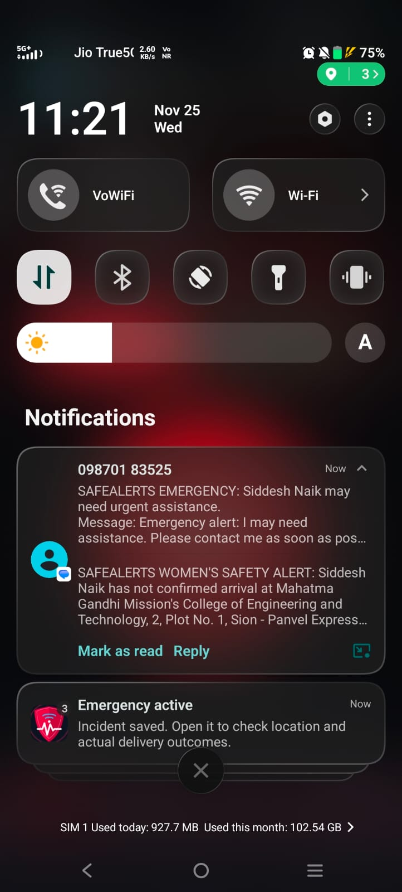
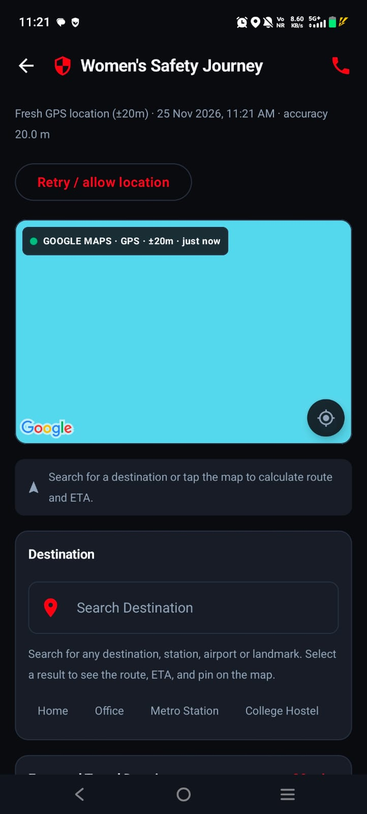
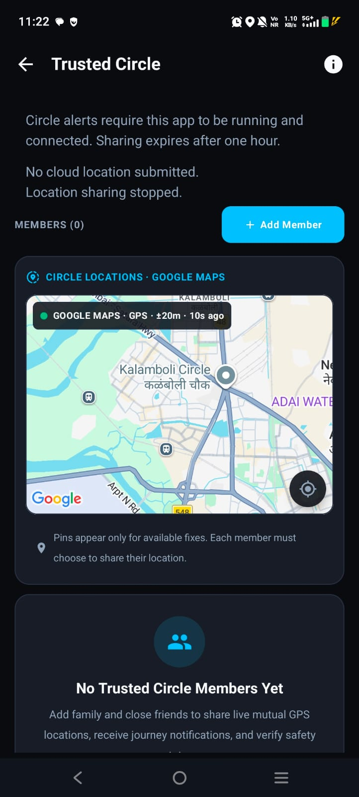
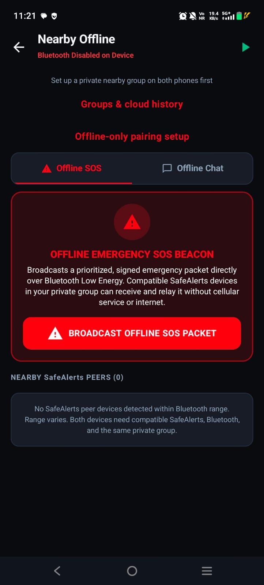

# SafeAlerts

**Personal Emergency Response, Live GPS Tracking & Offline BLE Mesh for Android**

[](https://safealertss-website.vercel.app/)
[](https://safealertss-website.vercel.app/assets/downloads/SafeAlerts-v1.0.1.apk)
[](https://github.com/corsal2006/SafeAlertss)

---

## 1. Project Overview

**SafeAlerts** (`com.siddesh.smsalerts`) is a native Android personal-safety application built with Kotlin and Jetpack Compose (Material 3). It unifies instant SOS triggering, automatic cellular SMS dispatch with live Google Maps coordinates, proactive journey tracking, consent-based Trusted Circle location sharing, and internet-free Bluetooth Low Energy (BLE) mesh communication in one resilient application.

- 🌐 **Interactive Web Portal & Video Demo:** [https://safealertss-website.vercel.app/](https://safealertss-website.vercel.app/)
- 📦 **Direct Android APK Download (v1.0.1):** [Download SafeAlerts-v1.0.1.apk](https://safealertss-website.vercel.app/assets/downloads/SafeAlerts-v1.0.1.apk)
- 🛠️ **Android Setup & Permissions Guide:** [View Step-by-Step Setup](https://safealertss-website.vercel.app/#setup-guide)
- 🏷️ **GitHub Releases:** [https://github.com/corsal2006/SafeAlertss/releases](https://github.com/corsal2006/SafeAlertss/releases)

> **Safety Notice:** SafeAlerts complements—and does not replace—official local emergency services (`112` / `1091` / `911`). SMS, GPS location, and Bluetooth features depend on device permissions, hardware, SIM/carrier availability, and network conditions.

---

## 2. Problem Statement

During high-stress personal emergencies, basic coordination breaks down into multiple slow, error-prone manual steps:

1. **Fragmented Emergency Actions:** Users under distress struggle to unlock their phone, copy GPS coordinates from a map app, and text multiple family members individually while calling emergency helplines.
2. **Accidental vs. Urgent Triggers:** Single-tap buttons without confirmation risk false alarms, while multi-menu workflows waste critical seconds when hands-free action is needed.
3. **Cellular & Internet Dead Zones:** Standard messaging and cloud-only safety apps fail completely inside basements, elevators, rural highways, or crowded events where mobile data drops.
4. **Uncoordinated Travel & Check-Ins:** Solo travelers, students, and shift workers often lack automated arrival monitoring that escalates only if they miss a check-in or destination deadline.
5. **Opaque Delivery Status:** Many safety tools assume an alert succeeded without reporting whether SMS, GPS lock, or cloud audit sync actually completed.

---

## 3. Proposed Solution

**SafeAlerts** addresses these gaps through a unified, permission-aware, offline-resilient Android emergency engine paired with an interactive web distribution portal ([safealertss-website.vercel.app](https://safealertss-website.vercel.app/)):

- **One-Flow Multi-Trigger SOS:** Initiate an alert via 1-Tap/2-Second Hold SOS button, background accelerometer **3× Shake Detection**, or Voice **`"HELP ME"`** recognition—all routed through a single 3-second countdown guard to confirm or cancel before dispatch.
- **Redundant Hybrid Delivery:** Dispatches native cellular SMS via Android `SmsManager` (with Google Maps coordinate links), synchronizes encrypted incident records to Cloud Firestore, and supports signed **Bluetooth LE Mesh SOS packets** when no internet or cellular signal exists.
- **Proactive Safety Journeys:** Combines **Women's Safety Journey** (Google Places Autocomplete destination search, OSRM route/ETA preview, automatic overdue escalation, and `1091` helpline quick dial) with configurable **Safety Check-In Timers**.
- **Consent-First Trusted Circle & Honest Telemetry:** Connects family members via single-use invite codes with 1-hour expiring location grants and displays transparent SMS/GPS/Cloud delivery outcomes on every incident.

---

## 4. Key Features

- **Multi-Trigger Emergency SOS:** Hold/Tap SOS dashboard button, Quick-Category presets (*Medical, Accident, Fire, Security*), background foreground-service Shake Detection (`3×`), and main-thread Voice trigger (`"HELP ME"`).
- **3-Second Countdown & Dispatch Guard:** Interactive circular timer with haptic feedback, live message telemetry preview, instant *Confirm & Dispatch Now*, and safe cancellation.
- **Native SMS Dispatch & Live GPS:** Attaches fresh GPS fixes (`±m` accuracy) and Google Maps URLs directly into SMS alerts to enabled contacts without faking delivery status.
- **Women's Safety Journey:** Search destinations via Google Places API (New), compute driving routes and ETAs via OSRM, track arrival countdowns with `+15m` extensions, and escalate automatically upon missed deadlines.
- **Safety Check-In Timer:** Background `AlarmManager` + `WorkManager` timers (`15m`, `30m`, `1h`, `2h`, or custom duration) with configurable grace periods (*Immediate* to *5 mins*).
- **Trusted Circle & Live Map:** Link accounts securely using single-use expiring invite codes, inspect member locations with staleness warnings on Google Maps, and toggle mutual sharing anytime.
- **Offline Bluetooth Low Energy (BLE) Mesh:** Broadcast prioritized signed emergency SOS beacons and encrypted peer text chat to nearby paired SafeAlerts devices without Wi-Fi or mobile data.
- **Emergency Contacts, History & Profiles:** Import/manage emergency contacts with local offline caching, review complete incident audit logs, verify permissions telemetry, and switch between Dark, Light, and System themes.

### App Screenshots Showcase

> Full interactive mobile walkthroughs and all 14 screens are also viewable inside a virtual phone frame at **[https://safealertss-website.vercel.app/#gallery](https://safealertss-website.vercel.app/#gallery)**.

| Login | Home Dashboard | 3s SOS Countdown | Active Incident Map |
|---|---|---|---|
|  |  |  |  |

| SMS Alert Delivery | Women's Safety | Trusted Circle | Offline BLE Mesh |
|---|---|---|---|
|  |  |  |  |

---

## 5. Technologies Used

| Layer | Technologies & Libraries |
|---|---|
| **Mobile App** | Kotlin, Jetpack Compose, Material 3, Navigation Compose, Coroutines & `StateFlow` |
| **Android Platform APIs** | `FusedLocationProviderClient`, `SmsManager`, `SensorManager`, `SpeechRecognizer`, `BluetoothAdapter` (BLE GATT), `WorkManager`, `AlarmManager`, Foreground Services (API 34+ types) |
| **Backend & Auth** | Firebase Authentication (Email/Password, Google Sign-In via Credential Manager, Email Link), Cloud Firestore, Firebase Cloud Messaging (FCM), Firestore Security Rules |
| **Maps, Search & Routing** | Google Maps SDK for Android, Maps Compose (`4.4.1`), Google Places API (New), OpenStreetMap Nominatim & OSRM Routing Engine |
| **Security & Persistence** | Android Keystore, AES-GCM / ECDSA signed BLE packets, Jetpack DataStore Preferences, Local Encrypted Incident & Contacts Cache |
| **Web Portal & Hosting** | HTML5, Modern CSS3 (Liquid Glassmorphism, Dark/Light Theme), Vanilla ES6 JS, **Vercel** ([safealertss-website.vercel.app](https://safealertss-website.vercel.app/)) |

---

## 6. Installation and Setup Instructions

### Option A — Install Directly on Your Android Phone (Recommended)

> Interactive visual walkthrough with phone screenshots: **[https://safealertss-website.vercel.app/#setup-guide](https://safealertss-website.vercel.app/#setup-guide)**

1. **Download the APK:**
   - Download directly from **[https://safealertss-website.vercel.app/assets/downloads/SafeAlerts-v1.0.1.apk](https://safealertss-website.vercel.app/assets/downloads/SafeAlerts-v1.0.1.apk)** (or via the **Download APK** button on [safealertss-website.vercel.app](https://safealertss-website.vercel.app/) / [GitHub Releases](https://github.com/corsal2006/SafeAlertss/releases)).
2. **Open Google Play Protect Settings:**
   - Open the **Google Play Store** → tap your profile icon (top-right) → **Play Protect** → tap the **Settings gear (⚙)** in the top-right corner.
3. **Temporarily Disable Play Protect Scanning & Install:**
   - Turn off **Scan apps with Play Protect** and **Improve harmful app detection**, then open the downloaded `.apk` file and tap **Install**.
4. **Sign In & Grant Permissions (Important for Android 13 / 14 / 15):**
   - Launch **SafeAlerts**, sign in with Google or Email, and allow all requested permissions.
   - To verify or grant manually: open **Android Settings → Apps → SafeAlerts → Permissions**.
   - **If any permission toggle (such as SMS or Background Access) is disabled/greyed out:** go back to the **App Info** screen, tap the **⋮ (three-dot menu)** in the top-right corner, and tap **Allow restricted settings** (or **Allow restricted permissions**).
5. **Confirm All 6 Permissions Are Allowed:**
   - Ensure **Contacts**, **Location** (*Allow all the time* recommended for background tracking), **Microphone**, **Nearby devices**, **Notifications**, and **SMS** all appear under **Allowed**.

---

### Option B — Developer Setup from Source

#### Prerequisites
- **Android Studio** (Jellyfish or newer) with Android SDK (`compileSdk 34`, `minSdk 24`)
- **JDK 17**
- A Firebase project configured for package ID `com.siddesh.smsalerts`

#### Setup Steps
1. **Clone the repository:**
   ```bash
   git clone https://github.com/corsal2006/SafeAlertss.git
   cd SafeAlertss
   ```
2. **Add Firebase configuration:**
   - Download `google-services.json` from your Firebase Console (with Email/Password + Google Sign-In enabled and Cloud Firestore active) and place it at `app/google-services.json`.
3. **Configure Maps API Key:**
   - Add your Google Maps / Places API key to `local.properties` or `secrets.properties` (excluded from Git):
     ```properties
     MAPS_API_KEY=your_google_maps_api_key_here
     ```
4. **Sync Gradle:**
   - Open the folder in Android Studio and let Gradle sync (`app/build.gradle.kts`).

---

## 7. How to Run the Project

### Run the Android Application & Tests
- **Android Studio:** Select the `app` run configuration, choose a physical Android device (recommended for SIM SMS & BLE) or Android Emulator (`API 24+`), and click **Run**.
- **Command Line (Build Debug APK):**
  ```powershell
  .\gradlew.bat assembleDebug
  ```
  Output APK: `app/build/outputs/apk/debug/app-debug.apk`
- **Command Line (Run Unit Tests):**
  ```powershell
  .\gradlew.bat testDebugUnitTest
  ```

### Run or Visit the Web Portal
- **Live Deployed Site (Vercel):** [https://safealertss-website.vercel.app/](https://safealertss-website.vercel.app/)
- **Preview Locally:**
  ```bash
  python -m http.server 8765 --directory website
  ```
  Then open `http://localhost:8765` in your browser.

---

## 8. Project Architecture & Workflow

### System Architecture

```text
+-------------------------------------------------------------------------+
|                       PRESENTATION LAYER (Jetpack Compose)              |
|  HomeScreen · SosCountdown · EmergencyReview · WomensSafety · Circle    |
|  SafetyCheckIn · OfflineMesh (WalkieTalkie) · Contacts · History        |
+------------------------------------+------------------------------------+
                                     | StateFlow / ViewModels
+------------------------------------v------------------------------------+
|                      EMERGENCY CORE & SERVICES                          |
|  EmergencyManager · LiveLocationManager · WomensSafetyManager           |
|  SafetyCheckInManager · EmergencyProtectionService (Foreground Service) |
|  SafetyTimerWork (WorkManager + AlarmManager) · EmergencyOutbox         |
+-------------------+--------------------------------+--------------------+
                    |                                |
        +-----------v-----------+        +-----------v-----------+
        | ANDROID DEVICE APIs   |        | CLOUD & ROUTING       |
        | • SmsManager (SMS)    |        | • Firebase Auth       |
        | • FusedLocation (GPS) |        | • Cloud Firestore     |
        | • Accelerometer Shake |        | • Google Places API   |
        | • SpeechRecognizer    |        | • Google Maps SDK     |
        | • BLE Mesh (GATT)     |        | • OSRM Routing API    |
        +-----------------------+        +-----------------------+
```

### Emergency Response Workflow

```text
  [ Trigger: SOS Button / Shake 3x / Voice "HELP" / Timer Expiry ]
                                 |
                                 v
           [ 3-Second Countdown Guard & Review Telemetry ]
                  |-- Cancel -------------------> [ Safe Abort ]
                  v
       [ Acquire Fresh GPS Fix + Lock Maps URL ]
                  |
                  +---> [ Native Cellular SMS (SmsManager) ]
                  +---> [ Cloud Firestore Audit & Circle Alerts ]
                  +---> [ Offline BLE Mesh Signed SOS Beacon ]
                  |
                  v
     [ Active Incident Screen -> "I'M SAFE — RESOLVE INCIDENT" ]
```

### Repository Structure

```text
SafeAlertss/
├── app/                     # Native Android application (Kotlin + Jetpack Compose)
├── website/                 # Interactive showcase portal deployed on Vercel
│   ├── index.html           # App demo, walkthroughs, 14-screen gallery & setup guide
│   ├── styles.css           # Glassmorphism theme matching Android Color.kt/Theme.kt
│   ├── app.js               # Autoplay video, 3s looping steppers, filters & lightbox
│   ├── vercel.json          # Vercel headers for APK download & MP4 playback
│   └── assets/              # Bundled APK, walkthrough video, and mobile screenshots
├── functions/               # Firebase Cloud Functions source
├── load_testing/            # Load-test tooling and recorded benchmarks
├── screenshots/             # Archived application screenshots
├── tools/                   # Verification and release utility scripts
└── firestore.rules          # Cloud Firestore access control & Trusted Circle rules
```

---

## 9. Team Members and Contributions

**Team GlitchX**

| Member | Role | Contributions |
|---|---|---|
| **Siddesh Naik** ([@corsal2006](https://github.com/corsal2006)) | Solo Developer & Team Lead | Architected and built the native Kotlin/Compose Android app, unified `EmergencyManager` dispatch pipeline, SMS & GPS telemetry, Women's Safety Google Places & OSRM routing, consent-based Trusted Circle & Firestore rules, BLE offline SOS/chat mesh, centralized permission system, end-to-end stability fixes, and the [SafeAlerts Vercel Web Portal](https://safealertss-website.vercel.app/). |

### Links & Contact
- 🌐 **Live App Website & APK:** [https://safealertss-website.vercel.app/](https://safealertss-website.vercel.app/)
- 💻 **GitHub Repository:** [https://github.com/corsal2006/SafeAlertss](https://github.com/corsal2006/SafeAlertss)
- 🔗 **LinkedIn:** [linkedin.com/in/siddesh-naik2](https://www.linkedin.com/in/siddesh-naik2)
- 📧 **Email:** `siddeshnaik292006@gmail.com`
